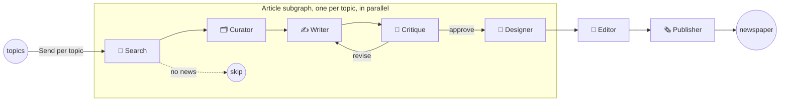

# 📰 GPT Newspaper

A personalized newspaper written by a newsroom of AI agents. Give it the topics you care about. It searches the news with [Tavily](https://tavily.com), picks the best sources, writes and fact-grounds each article, argues with its own editor until the story is good, then lays out a front page for you.

Built on [LangGraph](https://github.com/langchain-ai/langgraph) and [LangChain](https://github.com/langchain-ai/langchain), so it runs on **any chat model**: OpenAI, Anthropic, Google, Groq, Mistral, a local model through Ollama, and more.

<div align="center">

</div>

## ✨ What's new in v2

- **Bring any model.** Choose models with a single `provider:model` string, through LangChain's `init_chat_model`. You can set a server default or change it per edition in the UI.
- **Live newsroom.** The UI streams real progress from the graph: every topic, every stage, and the back-and-forth between the writer and the editor.
- **Structured outputs.** Agents return typed Pydantic objects through `with_structured_output`. Fragile "return only JSON" prompting and `json5` parsing are gone.
- **Modern LangGraph.** `StateGraph` with typed state, a per-topic subgraph, parallel fan-out with the `Send` API, runtime context, and a capped revision loop so the critic can't loop forever.
- **Grounded, cited articles.** Writers only use the curated sources, and every article lists them.
- **A fresh design.** A newsprint look for both the app and the generated paper, three redesigned layouts, dark mode, and mobile support.
- **One process, one port.** A FastAPI server replaces the two Flask processes, and generated pages are escaped HTML rendered with Jinja2.
- **Tested.** The whole graph runs in tests against a fake model and a fake search, so no API keys are needed to run them.

## 🗞️ The newsroom

Each topic gets its own reporter. All reporters work in parallel, and the editor assembles the paper when they're done.



| Agent | What it does |
|---|---|
| **Search** | Finds recent news for the topic with Tavily (`langchain-tavily`). If nothing turns up, it widens the time range. |
| **Curator** | Ranks the results and keeps the most relevant sources. It only keeps URLs that actually came from the search. |
| **Writer** | Writes the article grounded in those sources, then revises it based on the critic's feedback. |
| **Critique** | Reviews accuracy, clarity, and newsworthiness, then approves the piece or sends notes. The number of rounds is capped by `MAX_REVISIONS`. |
| **Designer** | Renders each article page, with its sources. |
| **Editor** | Lays out the front page in the layout you chose. |
| **Publisher** | Saves the edition and hands it back to the UI. |

## 🚀 Getting started

### Prerequisites

- Python 3.11+
- A [Tavily API key](https://tavily.com) (free tier available)
- An API key for your model provider, or a local [Ollama](https://ollama.com) install

### Run it

```sh
git clone https://github.com/rotemweiss57/gpt-newspaper.git
cd gpt-newspaper

cp .env.dist .env          # then add your keys
pip install -r requirements.txt
python app.py
```

Open **http://localhost:8000** and print your first edition.

<details>
<summary>Using <code>uv</code> instead</summary>

```sh
uv sync                     # or: uv sync --extra anthropic
uv run app.py
```
</details>

<details>
<summary>Using Docker</summary>

```sh
cp .env.dist .env          # then add your keys
docker compose up --build
```
</details>

## 🧠 Choosing a model

Set `LLM_MODEL` in `.env` to any model LangChain's [`init_chat_model`](https://python.langchain.com/docs/how_to/chat_models_universal_init/) supports, and install that provider's package:

| Provider | `LLM_MODEL` example | Install | Key |
|---|---|---|---|
| OpenAI (default) | `openai:gpt-5.4-mini` | included | `OPENAI_API_KEY` |
| Anthropic | `anthropic:claude-sonnet-5-5` | `pip install langchain-anthropic` | `ANTHROPIC_API_KEY` |
| Google | `google_genai:gemini-2.5-flash` | `pip install langchain-google-genai` | `GOOGLE_API_KEY` |
| Groq | `groq:llama-3.3-70b-versatile` | `pip install langchain-groq` | `GROQ_API_KEY` |
| Ollama (local) | `ollama:llama3.1` | `pip install langchain-ollama` | none |

You can also change the model for a single edition under **Model** in the UI. To turn that off on a shared server, set `ALLOW_MODEL_OVERRIDE=false`.

Other settings (all optional) are listed in [`.env.dist`](.env.dist): `LLM_TEMPERATURE`, `MAX_REVISIONS`, `SOURCES_PER_ARTICLE`, `NEWS_TIME_RANGE`, and `PORT`.

## 🔌 API

`POST /api/newspaper` streams newline-delimited JSON while the newsroom works:

```sh
curl -N localhost:8000/api/newspaper \
  -H 'Content-Type: application/json' \
  -d '{"topics": ["AI agents", "Space exploration"], "layout": "layout_3", "model": "anthropic:claude-sonnet-5-5"}'
```

```json
{"type": "progress", "topic": "AI agents", "index": 0, "stage": "search", "message": "Found 10 stories"}
{"type": "progress", "topic": "AI agents", "index": 0, "stage": "review", "message": "Editor: Lead with the funding news."}
{"type": "done", "url": "/outputs/run_1760000000_ab12cd/newspaper.html", "articles": 2}
```

`layout` is one of `layout_1` (Classic), `layout_2` (Digest), or `layout_3` (Front page). The v1 endpoint `POST /generate_newspaper` still works and returns `{"path": ...}` when the paper is done.

## 🧪 LangGraph Studio

The graph is exported in [`langgraph.json`](langgraph.json), so you can watch the agents in [LangGraph Studio](https://langchain-ai.github.io/langgraph/concepts/langgraph_studio/):

```sh
pip install "langgraph-cli[inmem]"
langgraph dev
```

Then run it with input like `{"topics": ["AI agents"], "layout": "layout_1"}`.

## 🗂️ Project structure

```
app.py                  # starts the server
backend/
  graph.py              # the LangGraph newsroom + streaming runner
  agents/               # one module per agent (search, curator, writer, critique, designer, editor, publisher)
  prompts.py            # LangChain prompt templates
  schemas.py            # Pydantic structured outputs
  state.py              # graph state
  llm.py                # init_chat_model: any provider
  config.py             # settings + per-run context
  server.py             # FastAPI: UI, streaming API, generated papers
  templates/            # Jinja2 templates for articles and newspaper layouts
frontend/               # the web app (plain HTML/CSS/JS, no build step)
tests/                  # end-to-end graph and API tests with a fake LLM
```

## 🤝 Contributing

Contributions are welcome! See the [Contributor's Guide](CONTRIBUTING.md). Run the tests with:

```sh
pip install pytest pytest-asyncio httpx && pytest
```

## 🛡️ Disclaimer

GPT Newspaper is an experimental project, provided "as is" without warranty. Articles are AI-generated from web sources and can contain mistakes. Check the sources before you rely on anything. It's meant for personal use, not as a replacement for professional journalism.

## 📩 Contact

- [Email](mailto:rotem5707@gmail.com)
