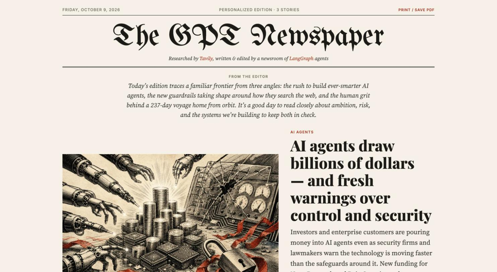
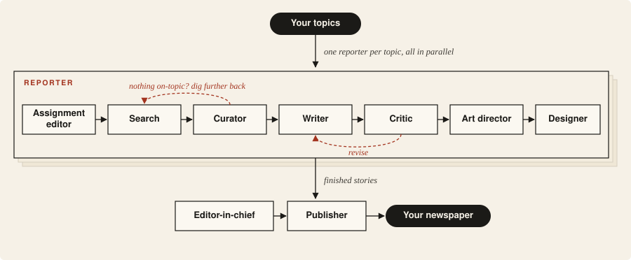

<div align="center">

# 📰 The GPT Newspaper

**Your own newspaper, researched, written, fact-checked and illustrated by a newsroom of AI agents.**

Tell it what you care about. Reporters search the news with [Tavily](https://tavily.com), editors argue
over every draft, an art director commissions illustrations, and the editor-in-chief hands you a
front page in about a minute. Every claim is cited.

[](https://github.com/rotemweiss57/gpt-newspaper/actions/workflows/ci.yml)
[](LICENSE)

[](https://github.com/langchain-ai/langgraph)



</div>

## ✨ Highlights

- **Any model.** One `provider:model` string through LangChain: OpenAI, Anthropic, Google, Groq,
  Mistral, xAI, DeepSeek, or a local model with Ollama. Pick a default on the server or switch per edition.
- **A real newsroom, not one prompt.** An assignment editor plans the coverage, reporters search in
  parallel, a curator throws out off-topic results, writers draft from full article text, a critic sends
  drafts back for revision, and an art director commissions the art.
- **Cited, grounded journalism.** Inline citations on every factual claim link to the numbered sources.
  Sources are treated as untrusted data, never as instructions.
- **Illustrations in a house style.** Ink, Engraving or Risograph art in the paper's own palette, sized
  for each layout slot and always labeled "AI illustration". Or use the sources' news photos.
- **Watch it work.** The newsroom streams live: every topic, every stage, the editor's notes to the
  writer, and stories landing on a live front page as they finish.
- **Resilient.** If a topic has no news this week, reporters dig further back. If a story fails, the
  rest of the edition still prints. Transient API errors are retried.
- **17 languages**, right-to-left included. **Print or save as PDF** with a proper print stylesheet.
- **Bring your own keys** in the UI (they stay in your browser), or configure them on the server.
- **Web app, API, CLI and LangGraph Studio**, from one codebase.

## 🚀 Quick start

You need Python 3.11+, a free [Tavily API key](https://app.tavily.com), and a key for your model
provider (or a local [Ollama](https://ollama.com)).

```sh
git clone https://github.com/rotemweiss57/gpt-newspaper.git
cd gpt-newspaper
pip install -r requirements.txt
python app.py
```

Open **http://localhost:8000**, add your keys under **Model & API keys**, pick some topics, and press
**Print my newspaper** (or <kbd>⌘</kbd>/<kbd>Ctrl</kbd> + <kbd>Enter</kbd>).

<details>
<summary><b>With uv</b></summary>

```sh
uv sync --extra anthropic   # extras: anthropic, google, ollama, groq, mistral, all
uv run app.py
```
</details>

<details>
<summary><b>With Docker</b></summary>

```sh
docker compose up --build
```

Keys can go in a `.env` file (see [`.env.example`](.env.example)) or in the web UI. Editions are saved
to `./outputs`.
</details>

## 🗞️ How the newsroom works

<p align="center"></p>

| Agent | Job |
|---|---|
| **Assignment editor** | Turns your topic into a few targeted news searches covering different angles. |
| **Search** | Runs them in parallel on Tavily's news index, with full article text, image candidates and favicons. |
| **Curator** | Keeps only sources that are really about your topic, ranks them, and picks the best photo. If nothing fits, the reporter widens the time range (week → month → year). |
| **Writer** | Writes a cited article from the sources, plus a headline, summary and pull quote, in your language. |
| **Critic** | Checks relevance, accuracy against the sources, citations and clarity. Approves, or sends notes back (up to `MAX_REVISIONS` rounds). |
| **Art director** | Commissions an illustration: a visual metaphor, no real people, rendered in the house style at the slot's exact size. |
| **Designer** | Lays out the article page with citations, pull quote, sources and reading time. |
| **Editor-in-chief** | Writes the note that opens the edition and composes the front page in your layout. |
| **Publisher** | Saves the edition and adds it to the archive. |

Everything is a [LangGraph](https://github.com/langchain-ai/langgraph) `StateGraph`: topics fan out with
the `Send` API, per-run settings travel in the runtime context, and progress is streamed with the stream
writer. Every LLM call is a LangChain runnable with a typed structured output, so swapping models is a
one-line change.

## 🧠 Models

Set `LLM_MODEL` (or use the **Model** field in the UI) to anything LangChain's
[`init_chat_model`](https://python.langchain.com/docs/how_to/chat_models_universal_init/) supports, and
install that provider's integration:

| Provider | Example | Install | Key |
|---|---|---|---|
| OpenAI (default) | `openai:gpt-5.4-mini` | included | `OPENAI_API_KEY` |
| Anthropic | `anthropic:claude-sonnet-5-5` | `pip install langchain-anthropic` | `ANTHROPIC_API_KEY` |
| Google | `google_genai:gemini-2.5-flash` | `pip install langchain-google-genai` | `GOOGLE_API_KEY` |
| Groq | `groq:llama-3.3-70b-versatile` | `pip install langchain-groq` | `GROQ_API_KEY` |
| Ollama (local) | `ollama:llama3.1` | `pip install langchain-ollama` | none |

**Illustrations** are drawn by `IMAGE_MODEL` (default `openai:gpt-image-2`) and need an OpenAI key, even
when the articles are written by another provider. Without one, editions use the sources' news photos.

## ⚙️ Configuration

All settings are optional environment variables (or a `.env` file). See [`.env.example`](.env.example).

| Variable | Default | What it does |
|---|---|---|
| `TAVILY_API_KEY` | | Tavily key (or enter it in the UI) |
| `LLM_MODEL` | `openai:gpt-5.4-mini` | Default chat model |
| `IMAGE_STYLE` | `ink` | `ink`, `engraving`, `risograph`, or `photos` |
| `IMAGE_MODEL` / `IMAGE_QUALITY` | `openai:gpt-image-2` / `medium` | Illustration model and quality |
| `SEARCHES_PER_TOPIC` | `2` | Searches planned per topic (`1` skips the planner) |
| `SOURCES_PER_ARTICLE` | `5` | Sources the curator keeps |
| `MAX_REVISIONS` | `2` | Writer ↔ critic rounds |
| `NEWS_TIME_RANGE` | `week` | Starting window; widened automatically when needed |
| `ALLOW_MODEL_OVERRIDE` | `true` | Let visitors choose a model per edition |
| `MAX_CONCURRENT_EDITIONS` | `4` | Editions printed at once (extra requests get HTTP 429) |
| `LANGSMITH_TRACING` | | Set to `true` (with `LANGSMITH_API_KEY`) to trace every agent step |

## ⌨️ CLI

Print an edition from your terminal, or from cron for a paper every morning:

```sh
python -m backend.cli "AI agents" "Formula 1" --layout front --images engraving --language es --open
```

## 🔌 API

`POST /api/newspaper` streams newline-delimited JSON while the newsroom works:

```sh
curl -N localhost:8000/api/newspaper -H 'Content-Type: application/json' -d '{
  "topics": ["AI agents", "Space exploration"],
  "layout": "layout_3",
  "images": "ink",
  "language": "en",
  "model": "anthropic:claude-sonnet-5-5"
}'
```

```json
{"type": "progress", "topic": "AI agents", "index": 0, "stage": "plan", "message": "Assigned: “AI agent funding” · “AI agent security”"}
{"type": "progress", "topic": "AI agents", "index": 0, "stage": "review", "message": "Editor: Lead with the funding news."}
{"type": "progress", "topic": "AI agents", "index": 0, "stage": "done", "message": "On the front page", "article": {"title": "…", "url": "…"}}
{"type": "done", "url": "/outputs/run_1760000000_ab12cd/newspaper.html", "articles": 2, "failed": 0}
```

Optional fields: `api_key` (model provider), `tavily_api_key`, and `image_api_key` override the server's
keys for that request. Layouts: `layout_1` (Classic), `layout_2` (Digest), `layout_3` (Front page). Also
available: `GET /api/editions` (archive), `GET /api/config`, `GET /api/health`, and the v1
`POST /generate_newspaper`.

## 🧪 LangGraph Studio

```sh
pip install "langgraph-cli[inmem]"
langgraph dev
```

Run the `newspaper` graph with `{"topics": ["AI agents"], "layout": "layout_1"}` and watch every agent.

## 🗂️ Project layout

```
app.py                 # starts the web server
backend/
  graph.py             # the LangGraph newsroom and the streaming runner
  agents/              # one module per agent
  prompts.py           # LangChain prompt templates
  schemas.py           # Pydantic structured outputs
  images.py            # illustration styles, slot sizes, image provider
  setup.py             # request → validated run context (shared by API and CLI)
  server.py            # FastAPI: UI, streaming API, archive, security headers
  cli.py               # command-line interface
  templates/           # Jinja2 newspaper layouts and article page
frontend/              # the web app: plain HTML, CSS and JS, no build step
tests/                 # the full graph and API, against a fake model, search and image provider
```

## 🤝 Contributing

Contributions are very welcome. Read the [contributing guide](CONTRIBUTING.md), and run the checks
before opening a PR:

```sh
uv sync && uv run pytest && uv run ruff check . && uv run ruff format --check .
```

Found a security issue? Please follow the [security policy](SECURITY.md).

## 🛡️ Disclaimer

GPT Newspaper is an experimental project, provided "as is". Articles are generated by AI from web
sources and can contain mistakes: check the cited sources before relying on anything. Illustrations are
AI-generated and labeled as such. It's meant for personal use, not as a replacement for professional
journalism.

## 📩 Contact

[rotem5707@gmail.com](mailto:rotem5707@gmail.com) · MIT licensed
